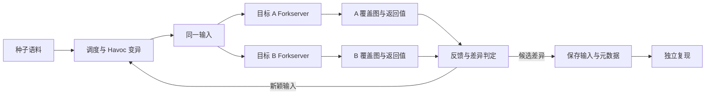

# DiffRay：基于 Rust 的双目标差分模糊测试原型

DiffRay 使用同一份输入驱动两个程序实现，分别收集覆盖信息和语义返回值，
通过反馈指导输入变异，并保存值得复现的行为差异。核心由 **Rust 2021 + LibAFL**
实现，被测程序通过插桩和 harness 接入。

这是为 Rust 软件原型系统大赛整理的经典版本，基于历史提交
`75c1e02`（2026-02-06）。参见[来源与依赖](docs/contest/provenance.md)。

## 五分钟真实库演示

准备 Linux x86_64 环境，安装 Rust/rustup、Python 3、Make、GCC 与 Clang/LLVM。
Ubuntu 24.04 的编译依赖可用以下命令安装：

```bash
sudo apt-get install build-essential clang-18 llvm-18-dev \
  libclang-18-dev libclang-rt-18-dev pkg-config python3 git
git submodule update --init LibAFL
rustup toolchain install 1.91.1 --profile minimal --component rustfmt
export PATH="/usr/lib/llvm-18/bin:$PATH"
export LLVM_CONFIG=/usr/lib/llvm-18/bin/llvm-config
```

仓库的 `rust-toolchain.toml` 固定使用 Rust 1.91.1。首次构建需要网络下载依赖；
根项目与 `app/compiler` 均保留各自的 `Cargo.lock`。

```bash
# 校验固定源码并构建 DiffRay、cJSON 1.7.19 与 mjson 1.2.7。
just real-json-build

# 单独检查两个适配器的共同契约和供应链清单。
just real-json-verify

# 从两侧行为一致的种子出发，执行 30 秒差分模糊测试。
just real-json-demo 30

# 稳定复现仓库中的已知真实解析差异。
just real-json-replay
```

两个目标都把“完整输入是 JSON 对象”映射为返回值 `0`，把无效 JSON 或非对象
映射为 `1`，空输入映射为 `100`。最新 mjson 对部分非标准字符串转义较宽松，
因此 `examples/real-json/known-difference.json` 会得到 **cJSON=1、mjson=0**。
这是库之间的兼容性差异，不自动等于安全漏洞。

每次 fuzz 会创建独立的 `run/real-json/campaign-*` 目录，保存差分输入、隐藏的
`.*.metadata`、日志与 `summary.json`。脚本只统计能够在 forkserver 外再次得到
不同返回值、且元数据与重放一致的样本。30 秒运行仍有随机性；固定样本的 replay
用于稳定展示。完整说明见[真实库演示](docs/contest/real-json-demo.md)。

原有合成数字解析器仍作为快速冒烟测试保留：`just contest-verify`、
`just contest-demo 30` 和 `just contest-replay`。

## 系统如何工作



- 两侧各自拥有覆盖图和返回值共享内存，避免将两个目标的观测混为一谈。
- `DiffExecutor` 顺序执行两个 forkserver，反馈决定哪些输入进入后续变异队列。
- 当前主入口的语义判据为 **一侧返回 0、另一侧返回非 0**，不是比较任意输出文本。
- 保存条件为“崩溃/超时或语义差异”并结合组合覆盖图的新颖性筛选。
  保存结果需要复现，不能将候选差异直接当作漏洞。

## 已有反馈模式

`--mode` 切换种子保留策略；差异判据由主入口单独构造。

| 模式 | 反馈依据 |
| --- | --- |
| `single-cov` | 任一侧的覆盖新颖性；参赛演示默认模式 |
| `combo-cov` | 两侧覆盖索引集合的组合新颖性 |
| `single-rv` / `combo-rv` | 单侧返回值 / 两侧返回值元组的新颖性 |
| `single-pl` / `combo-pl` | 单侧覆盖索引数量 / 两侧数量组合的新颖性 |
| `single-rv-cov` | 返回值零/非零状态差异与单侧 `(返回值, 覆盖索引集合)` 新颖性 |
| `replay-cov` | 对已有语料执行覆盖回放，不进入无限 fuzz 循环 |

这些是历史实现提供的模式；本次演示验收以 `single-cov` 为准。
覆盖索引数量和集合不等于完整有序执行路径。

## 项目导航

| 位置 | 内容 |
| --- | --- |
| [src/](src/) | Rust 驱动、反馈、观察器和差异目标 |
| [app/compiler/](app/compiler/) | 原有编译器包装器、forkserver 与返回值运行时 |
| [examples/real-json/](examples/real-json/) | cJSON/mjson 适配器、种子与已知差异 |
| [third_party/](third_party/) | 固定的上游解析器源码、许可证与校验清单 |
| [scripts/real_json_demo.py](scripts/real_json_demo.py) | 真实库构建、限时 fuzz、元数据校验与复现入口 |
| [examples/contest/](examples/contest/) | 自包含合成冒烟目标 |
| [scripts/contest_demo.py](scripts/contest_demo.py) | 合成演示入口 |
| [真实库演示说明](docs/contest/real-json-demo.md) | 目标契约、现场命令、结果解释与安全边界 |
| [参赛介绍与演示讲稿](docs/contest/README.md) | 项目简介、展示顺序与待补充信息 |
| [验证记录](docs/contest/verification.md) | 本次环境、执行结果与已知限制 |
| [项目结构](docs/STRUCTURE.md) | 与当前经典版本对应的模块说明 |

`app/` 的其他目标、`experiments/`、`docker/` 和旧 `Justfile` 配方属于历史研究材料，
部分依赖原机器路径和外部库。演示只需初始化 `LibAFL`；根部旧 `LocateFix` 和
外部 fuzzer 子模块已经移除。请使用 `real-json-*` 或 `contest-*` 配方，旧
`run` / `pre_run` 等历史配方可能清空 `run/`。

## 开发验证

```bash
cargo check --locked --all-targets --workspace
cargo test --locked --workspace
python3 -m unittest tests.test_real_json_demo -v
just contest-verify
just real-json-verify
```

Rust 1.98 会触发旧 LibAFL 的新增 lint 错误，请先使用固定工具链。
Clang 18 下上游可选 `dump-cfg-pass.cc` 可能给出跳过警告；本演示使用
SanitizerCoverage `trace-pc-guard`，不依赖该 pass。

DiffRay 原创实现与 LibAFL 等上游组件的归属见[来源说明](docs/contest/provenance.md)。
正式提交前仍需补充比赛规定的团队信息、材料格式与授权文件。
