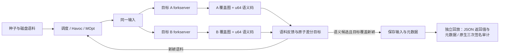

# PairFuzz：基于 Rust 的双目标差分模糊测试系统

PairFuzz 用同一输入驱动两个程序实现，隔离收集两侧覆盖图和语义返回值，通过反馈引导
语料保留与变异，并把可复现的行为差异连同元数据保存下来。核心调度、状态管理、
双目标执行、反馈、进程生命周期和回放由 **Rust 2021 + LibAFL 0.16.1** 实现；本地
C/C++ 目标通过 forkserver、共享内存和 SanitizerCoverage 接入。

当前实现包含 LibAFL 0.16.1 快速单客户端管线、完整 `u64` 语义结果、稳定差分签名，
以及 JSON、PNG、BMP 和 X.509 四组双目标工作负载。

## 环境

推荐 Linux x86_64（当前验证环境为 Ubuntu 24.04），需要 Rust/rustup、Python 3、
Make、GCC、Clang/LLVM、Git 和 [just](https://github.com/casey/just)。仓库通过
`rust-toolchain.toml` 固定 Rust **1.93.1**，通过 gitlink 固定 LibAFL **0.16.1**；根项目
与 `app/compiler/` 各自使用锁文件。

Ubuntu 可先安装基础依赖：

```bash
sudo apt-get install build-essential clang-18 llvm-18-dev \
  libclang-18-dev libclang-rt-18-dev pkg-config cmake python3 git
git submodule update --init LibAFL
rustup toolchain install 1.93.1 --profile minimal --component rustfmt
cargo install just --locked
export PATH="/usr/lib/llvm-18/bin:$PATH"
export LLVM_CONFIG=/usr/lib/llvm-18/bin/llvm-config
```

首次 Rust 构建需要取得锁定 crate。原生 PNG/BMP/X.509 发布门禁还会下载锁定的上游
源码并消耗较多磁盘与构建时间；它不是下面最小用例的前置条件。

## 最小运行用例：cJSON 与 mjson

cJSON 1.7.19 与 mjson 1.2.7 是评分和快速复现使用的最小运行用例。两侧共同契约把
“完整输入是 JSON 对象”映射为 `0`，把无效 JSON 或非对象映射为 `1`，空输入映射为
`100`。

```bash
# 构建 PairFuzz 和两个固定版本目标。
just real-json-build

# 校验第三方字节、共同契约、五个一致种子和固定真实差异。
just real-json-verify

# 稳定复现仓库中的已知解析差异。
just real-json-replay

# 可选：从两侧行为一致的种子开始运行 30 秒有界 campaign。
just real-json-demo 30
```

固定夹具 `examples/real-json/known-difference.json` 的预期结果是
**cJSON=1、mjson=0**。这是两个解析器的兼容性差异，不自动等于安全漏洞。有限时长
campaign 具有随机性；若没有保存解，脚本会保留日志而不会用固定夹具替代随机发现。
保存样本只有在 forkserver 外独立复现、且元数据与返回值一致后才计数。

## 扩展验证：规范化原生语义

PairFuzz 还完整支持三组从固定源码构建的原生目标：

| 操作 | 目标 A | 目标 B | 规范化结果 |
| --- | --- | --- | --- |
| PNG 解码 | libpng 1.6.59 | libspng 0.7.4 | 尺寸与 RGBA8 |
| BMP 解码 | ImageMagick 7.1.2-34 | GraphicsMagick 1.3.48 | 尺寸与 RGBA8 |
| DER X.509 解析 | OpenSSL 4.1.0 | wolfSSL 5.9.4 | 重编码 DER |

harness 将结果类别和规范化结果指纹编码进完整 `u64`。当前共享内存传输使用
16 字节布局（语义值与发布标志），用发布标志区分有效零值与未写回结果；升级后必须
重新构建目标及其静态运行时，不能复用旧 ABI 的目标二进制。fast 管线使用
`result-policy=exact`、signature v2 和原子差分目标：先比较语义码，再仅为候选计算双侧
覆盖签名；保存仍要求新的差分目标覆盖。独立 replay 连续执行三次，并用规范化
SHA-256 审计紧凑指纹。

完整发布门禁为：

```bash
just real-targets-check
```

该命令会取得并校验八个锁定来源，构建 ASan/release 目标，并运行 PNG、BMP、X.509
契约与既有 JSON 验证，因而需要网络、本地可用的 Clang/LLVM 工具链、数 GiB 临时磁盘和
较长构建时间。可通过 `real-targets-fetch`、`real-targets-build`、
`real-targets-verify`、`real-targets-run` 和 `real-targets-replay` 分别操作单个 pair；
使用 `just --list` 查看完整参数。分发链接 wolfSSL 的产物前必须履行对应
GPL-3.0-or-later 义务。

## 系统结构



- 两侧覆盖图和语义共享内存彼此隔离，子进程每次执行前清零观测状态。
- legacy 管线保留历史 QueueScheduler/Havoc 行为；fast 管线提供缓存磁盘语料、校准、
  加权调度、确定性 campaign seed、Havoc/MOpt 与 token 字典。
- JSON 最小用例沿用零/非零返回值判据；原生目标比较完整 `u64` 语义码。
- 候选差异不是漏洞结论；短时 smoke 的零保存解也不能证明两个库完全等价。

## 验证与开发

普通回归门禁不会重新构建所有大型原生库：

```bash
just check
```

它构建并验证合成/真实 JSON 目标，执行 Rust 与 Python 测试。可选 LLVM CFG pass 未找到
时 LibAFL 会给出警告；当前目标使用 `trace-pc-guard`，不依赖该 pass。原生目标的完整
发布门禁单独使用 `just real-targets-check`。

## 项目导航

| 位置 | 内容 |
| --- | --- |
| [src/](src/) | Rust 运行时、legacy/fast 客户端、反馈、语义目标和观察器 |
| [app/compiler/](app/compiler/) | 插桩包装器、forkserver 静态运行时和 `u64` 语义共享内存 ABI |
| [examples/real-json/](examples/real-json/) | cJSON/mjson 最小用例、种子与固定差异 |
| [examples/real-targets/](examples/real-targets/) | PNG/BMP/X.509 适配器、契约和小型夹具 |
| [scripts/](scripts/) | 构建、验证、campaign 和回放入口 |
| [third_party/](third_party/) | JSON vendored 字节、原生来源锁和许可证清单 |
| [tests/](tests/) | 供应链、ABI、契约、进程生命周期和结构回归 |

PairFuzz 原创代码采用 [MIT 许可证](LICENSE)。第三方材料继续遵循各自许可证，版本、
来源和分发义务见 [THIRD_PARTY.md](THIRD_PARTY.md)。
